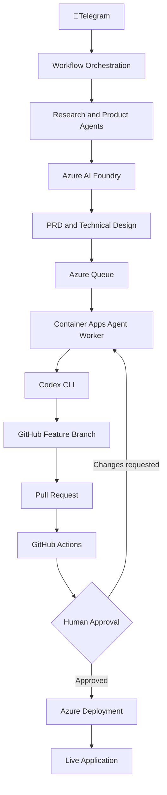

# Personal AI Builder Lab

### From a mobile idea to a deployed product. An agentic engineering platform powered by Azure.


**Personal AI Builder Lab** is a mobile-first, Azure-powered agentic development environment designed to turn ideas into researched, specified, built, tested and deployed software products.

It combines AI models, autonomous coding agents, reusable agent skills, workflow orchestration and cloud infrastructure into a practical system for the complete product development lifecycle.

The ambition:

**Make building software as easy as describing what should exist, while maintaining the engineering discipline required to ship it.**

---

## The vision

An idea submitted from a handheld device should be enough to initiate a complete product development workflow.

The system researches the opportunity, investigates competitors, assesses technical feasibility and produces a product specification.

A coding agent takes over implementation, creates a feature branch, writes tests and opens a pull request.

Automated quality gates validate the changes. A human reviews the result, approves the release and receives a link to the deployed application.

GitHub remains the engineering system of record. Azure provides the execution and AI infrastructure. The human remains in control of consequential decisions.

## Architecture



## Technology stack

| Layer | Technology | Responsibility |
|---|---|---|
| Mobile interface | Telegram | Commands and notifications |
| Orchestration | n8n Community Edition | Workflow coordination |
| AI platform | Azure AI Foundry | Model access and inference |
| Coding agent | OpenAI Codex CLI | Autonomous implementation |
| Interactive AI | ChatGPT subscription | Human-led coding and experimentation |
| Azure coding inference | Azure OpenAI | Unattended coding workloads |
| Agent execution | Azure Container Apps | Isolated container workers |
| Task messaging | Azure Storage Queue | Asynchronous task dispatch |
| Workflow database | Azure Database for PostgreSQL | State and execution history |
| Secrets | Azure Key Vault | Credentials and API keys |
| Container registry | Azure Container Registry | Private container images |
| Source control | GitHub | Issues, branches, PRs and releases |
| CI/CD | GitHub Actions | Automated validation and deployment |
| Frontend hosting | Azure Static Web Apps | Web application hosting |
| Backend hosting | Azure Container Apps | APIs and application services |
| Monitoring | Azure Monitor | Logs and operational visibility |

## Two coding modes

The lab supports two complementary execution modes.

### Interactive development

Codex CLI authenticates through an existing ChatGPT subscription.

Use cases:
- Exploring ideas and prototypes.
- Interactive code generation.
- Debugging and refactoring.
- Architecture experimentation.
- Human-guided development.

### Azure autonomous development

Codex CLI uses an Azure OpenAI model deployment through a custom provider configuration.

Use cases:
- Asynchronous coding tasks.
- Automated implementation workflows.
- Scheduled engineering tasks.
- Repository maintenance.
- Agent-driven testing and documentation.

Both modes use reusable skills and GitHub-based workflows.

Azure model deployments are selected according to model availability, Responses API compatibility and cost.

## Agent capabilities

The initial skill library covers:

| Skill | Responsibility |
|---|---|
| `market-research` | Market and competitor analysis |
| `product-discovery` | Problem framing and opportunity assessment |
| `prd-generator` | Product requirements and user stories |
| `architecture-design` | System architecture and ADRs |
| `frontend-engineering` | UI implementation |
| `backend-engineering` | API and data implementation |
| `test-engineering` | Test design and automation |
| `security-review` | Security and dependency analysis |
| `github-workflow` | Issues, branches and pull requests |
| `documentation` | Technical documentation |

Skills are version-controlled, reusable and independently maintainable.

## Engineering lifecycle

Every project follows a traceable development process:

1. Idea submission.
2. Research and discovery.
3. Product requirements.
4. Architecture and technical planning.
5. GitHub issue creation.
6. Feature branch creation.
7. Agent implementation.
8. Automated testing and security checks.
9. Pull request and human review.
10. Approved deployment.
11. Release documentation.

### Engineering guardrails

- No direct commits to `main`.
- Protected branches and mandatory pull requests.
- Automated CI checks.
- Isolated coding environments.
- Restricted GitHub permissions.
- Secrets managed through Azure Key Vault.
- GitHub Actions authentication through OIDC.
- Explicit human approval for production releases.

## Azure architecture

Azure is the infrastructure and AI execution platform.

| Service | Purpose |
|---|---|
| Container Apps | n8n and agent execution |
| Container Apps Jobs | On-demand agent workloads |
| AI Foundry | AI model management |
| Azure OpenAI | Model inference for coding and research |
| PostgreSQL Flexible Server | Persistent workflow state |
| Storage Account | Task queues and project artifacts |
| Key Vault | Secrets management |
| Container Registry | Private container images |
| Azure Monitor | Logs and monitoring |
| Static Web Apps | Frontend deployment |

The architecture uses consumption-based compute wherever practical. Agent workers should scale to zero when idle.

## Cost strategy

The target infrastructure budget is the available **€130/month Azure credit**.

Target consumption: €95–110/month, with the remaining credit reserved for usage fluctuations.

Cost management principles:

- Pay-per-token AI inference.
- No provisioned model capacity.
- Consumption-based container execution.
- On-demand coding workers.
- Small Burstable PostgreSQL instance.
- Free GitHub and frontend hosting tiers where possible.
- Execution and token usage tracking.

Existing ChatGPT subscription costs are separate from Azure consumption.

## Repository structure

```text
personal-ai-builder-lab/
├── agents/
│   ├── research/
│   ├── product/
│   ├── engineering/
│   └── quality/
├── orchestrator/
│   └── workflows/
├── skills/
│   ├── market-research/
│   ├── product-discovery/
│   ├── architecture-design/
│   ├── engineering/
│   └── security-review/
├── workers/
│   ├── codex/
│   └── shared/
├── infrastructure/
│   ├── bicep/
│   └── scripts/
├── templates/
│   └── project-template/
├── docs/
│   ├── architecture.md
│   ├── security.md
│   ├── deployment.md
│   └── decisions/
├── .github/
│   └── workflows/
├── docker-compose.yml
├── .env.example
└── README.md
```

## Roadmap

- [ ] Azure foundation and cost controls.
- [ ] Container Apps environment.
- [ ] n8n deployment and PostgreSQL integration.
- [ ] Telegram command interface.
- [ ] Azure AI Foundry model deployment.
- [ ] Interactive and Azure-billed Codex configurations.
- [ ] Isolated agent execution workers.
- [ ] GitHub App integration.
- [ ] GitHub Actions and OIDC.
- [ ] Automated testing and security gates.
- [ ] Preview and production deployments.
- [ ] First end-to-end demonstration project.

## Success metrics

| Metric | Purpose |
|---|---|
| Cost per completed feature | Engineering economics |
| Time from idea to prototype | Delivery speed |
| PR acceptance rate | Code quality |
| Automated test pass rate | Reliability |
| Human intervention rate | Agent autonomy |
| Deployment success rate | Delivery reliability |
| Research source coverage | Evidence quality |
| Azure consumption per project | Infrastructure efficiency |

## Why this project?

AI-assisted coding is becoming increasingly accessible. The more interesting challenge is designing systems that reliably connect discovery, product thinking, engineering execution and software delivery.

Personal AI Builder Lab explores that challenge through practical experimentation with agentic AI, Azure infrastructure, reusable skills and human-agent collaboration.

**The goal is not to maximize the number of agents. It is to maximize the amount of useful software that can be shipped responsibly.**

---

*An evolving exploration of agentic software development, cloud engineering and the future of AI-powered building.*
