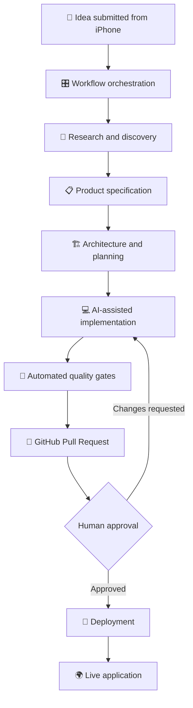

# personal-ai-builder-lab

# Personal AI Builder Lab

### From an idea on your phone to a deployed product — powered by AI agents.

**Personal AI Builder Lab** is a mobile-first, agentic development environment designed to turn ideas into researched, specified, built, tested and deployed software products.

It combines specialized AI capabilities, reusable agent skills, workflow orchestration and modern developer tooling into a cost-conscious system that supports the complete product development lifecycle.

The ambition is simple:

**Make building software as easy as describing what should exist, without compromising the engineering discipline required to ship it.**

---

## The vision

What if a product idea submitted from your phone could trigger an entire product development workflow?

You describe a problem. AI agents investigate the opportunity, explore existing solutions, assess technical feasibility and produce a product specification.

A coding agent takes over implementation, creates a feature branch, writes tests and opens a pull request.

Automated quality gates validate the changes. You review the result, approve the release and receive a link to the deployed application.

All while keeping GitHub as the system of record.

Personal AI Builder Lab aims to make this workflow repeatable, observable and accessible from anywhere.

## How it works

Every meaningful development activity should leave an auditable trace in GitHub.

## Core capabilities

### 1. Mobile-first interaction

Initiate and monitor development workflows from an iPhone.

- Submit ideas using natural language.
- Start research and development tasks.
- Monitor execution progress.
- Receive notifications when agents complete work.
- Review and approve critical actions.

Initial interaction layer: Telegram.

### 2. Agent-powered product discovery

Turn an initial idea into an evidence-based product opportunity.

- Market and competitor research.
- Problem and user exploration.
- Technical feasibility assessment.
- Opportunity and differentiation analysis.
- MVP definition and prioritization.
- Product requirements and acceptance criteria.

Research outputs must distinguish verified evidence from assumptions and hypotheses.

### 3. Autonomous engineering

Delegate implementation to coding agents operating in controlled environments.

- Repository exploration.
- GitHub issue creation.
- Feature branch management.
- Code generation and refactoring.
- Test generation and execution.
- Pull request creation.
- Technical documentation.

The system should support interchangeable coding agents rather than depend on a single vendor.

### 4. Engineering quality and governance

Autonomy does not mean unrestricted execution.

GitHub remains the source of truth for the development lifecycle.

- Feature branches instead of direct commits to `main`.
- Pull requests for all meaningful changes.
- Automated testing and linting.
- Dependency and security checks.
- Human review before merging.
- Explicit approval for production releases.

### 5. Continuous deployment

Move from prototype to working application.

- Automated CI/CD through GitHub Actions.
- Preview environments.
- Deployment to Cloudflare.
- Release documentation.
- Live application URLs.

## Technology stack

The initial architecture prioritizes proven tools, composability and low operating costs.

| Layer | Technology | Responsibility |
|---|---|---|
| Mobile interface | Telegram | Commands and notifications |
| Orchestration | n8n | Workflow coordination |
| Coding agent | OpenAI Codex CLI | Software implementation |
| Agent skills | Agent Skills | Reusable capabilities |
| Integration | MCP | Tool connectivity |
| Source control | GitHub | SDLC and governance |
| CI/CD | GitHub Actions | Automated validation |
| Hosting | Cloudflare | Application deployment |
| Infrastructure | Hetzner VPS | Persistent execution |
| Database | PostgreSQL | Workflow state |

Technologies are replaceable by design. The architecture should preserve the ability to introduce alternative models, coding agents and orchestration frameworks.

## Agent skills

Rather than building a collection of isolated agents, the lab uses reusable skills to establish consistent ways of working.

| Skill | Responsibility |
|---|---|
| `market-research` | Market and competitor analysis |
| `product-discovery` | Problem framing and opportunity assessment |
| `prd-generator` | Product requirements and user stories |
| `architecture-design` | System architecture and ADRs |
| `frontend-engineering` | User interface implementation |
| `backend-engineering` | API and data implementation |
| `test-engineering` | Test design and automation |
| `security-review` | Security and dependency analysis |
| `github-workflow` | Issues, branches and pull requests |
| `documentation` | Technical documentation and README generation
